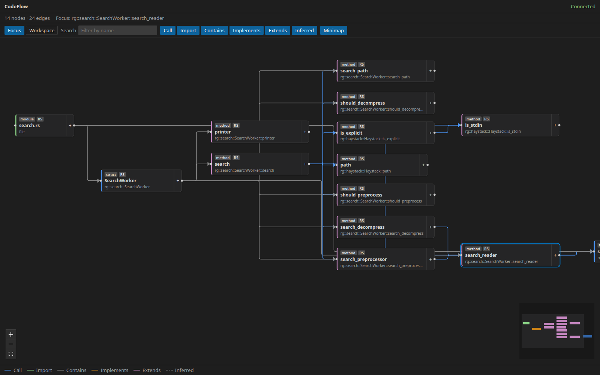
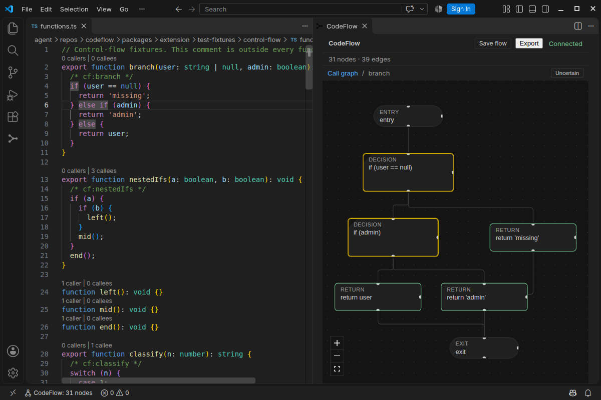
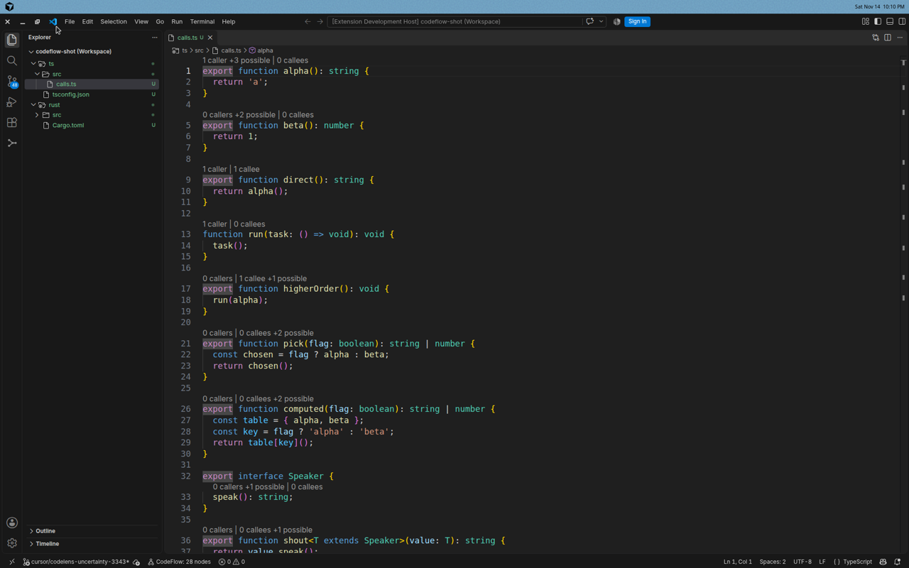

# Rezis CodeFlow

CodeFlow draws how your code runs, beside the code. Call graphs, flowcharts, sequence diagrams, Rust trait maps, and request traces for TypeScript, JavaScript, and Rust. Analysis stays on your machine. There is no telemetry.

Install **Rezis CodeFlow** from the Extensions view in Cursor or VS Code. The extension id is `rezis-work.rezis-codeflow`. Cursor installs it from [Open VSX](https://open-vsx.org/extension/rezis-work/rezis-codeflow). VS Code installs it from the [Marketplace](https://marketplace.visualstudio.com/items?itemName=rezis-work.rezis-codeflow).

Open a supported file and run **CodeFlow: Show Flow for Symbol at Cursor** (right-click, or Ctrl+Alt+F, Cmd+Alt+F on macOS). Click a node to open that symbol. Move the cursor and the diagram follows.

## Features

### Call graph

**CodeFlow: Show Flow for Symbol at Cursor** draws the neighbourhood of the symbol under the cursor, two calls out in every direction. The toolbar can switch that view to the whole workspace graph. Certain calls are solid. Inferred and uncertain calls are dashed. Click a node to select it in the editor. The expand control asks for a wider neighbourhood.

### Callers and callees

**CodeFlow: Show Callers** walks incoming calls. **CodeFlow: Show Callees** walks outgoing calls. The depth is `codeflow.editor.callDepth` (default 2). Both commands are in the editor context menu.

### File dependencies

**CodeFlow: Show File Dependencies** draws the import edges of the current file. **CodeFlow: Show Dependencies** does the same for a file in the explorer, or for the files in a folder plus one import hop.

### Control flow

**CodeFlow: Show Control Flow for Function at Cursor** draws a top-to-bottom flowchart of the function at the cursor, for TypeScript, JavaScript, and Rust. Decisions, switches, loops, `try` / `catch` / `finally`, early returns, `await`, and `yield` are blocks. Rust also covers `match`, `loop`, `?`, and `unwrap` / `expect` (the panic edge is uncertain). A function or method node in the call graph has a Flow button that opens the same view. Click a block to select its source.

### Trait map

**CodeFlow: Show Trait Map** is Rust only. On a trait it draws the trait, its supertraits, every workspace impl, and the methods those impls override or inherit. On a type it draws the traits that type implements. A call through `dyn Trait`, a generic bound, or `impl Trait` fans out to the workspace impls and is drawn dashed.

### Request flow and entry points

**CodeFlow: Show Request Flow** traces one route through its handler and the calls below it, and ends at a data-layer sink when the trace reaches a known client. Put the cursor in a handler and the command traces that route. Otherwise it asks you to pick one.

The CodeFlow side panel lists every detected entry point, grouped by framework and package. A row opens the trace. Source jumps to the handler. Saving a route file refreshes that file's entries. Nothing is executed. Detection is static.

### Sequence

**CodeFlow: Show as Sequence** turns a function's calls, or a request trace, into a timeline. Lifelines group by file, by class / impl / struct, or by module / crate. Calls run downward, with a return arrow. An uncertain call stays dashed. The side panel and the request diagram each have a Sequence button. Graph on the sequence returns to the call diagram.

### CodeLens and uncertainty

Above each function and method, CodeLens shows the call-graph degree, for example `3 callers` and `5 callees`. An uncertain call is left out of that number and shown beside it (`+1 possible`). Click a count to open Show Callers or Show Callees. `codeflow.codeLens.enabled` turns the lenses off.

Uncertain edges are dashed everywhere: callbacks, dependency injection, dynamic dispatch (`dyn Trait`), generic bounds, macros, and computed calls. The tooltip names the reason. The **Uncertain** switch hides them.

### Saved flows

**Save flow** names the diagram you are looking at: the view, the symbol or entry point, depth or granularity, the uncertain and inferred switches, collapsed nodes, and the viewport. Opening it analyzes the current code. If that symbol is gone, CodeFlow shows the last picture and says the flow is stale. The side panel lists saved flows (open, rename, delete). By default they stay in this window's storage. `codeflow.savedFlows.storeInWorkspace` writes `.codeflow/flows.json` so you can commit them.

### Export

**Export** saves the open diagram as PNG, SVG, or Mermaid, or copies the Mermaid source. Uncertain edges stay dashed. PNG scale is `codeflow.export.pngScale` (default 2). `codeflow.export.background` follows the theme or forces a white page. Exported diagrams use a deterministic layout, not the on-screen positions.

### Performance

The first diagram does not wait for the whole repository. CodeFlow analyzes the file you asked for and a depth-2 neighbourhood of at most 64 files and 2.5 MB of source, then indexes the rest in the background. The status bar shows `CodeFlow: indexing completed/total`. Click it, or run **CodeFlow: Cancel Indexing**, to stop. Files already analyzed stay.

Results are stored in the window's local storage, keyed by content hash, analyzer version, and toolchain. The next open of an unchanged file is read from that cache. `codeflow.cache.enabled` (default on) turns the cache off without deleting it. **CodeFlow: Clear Cache** deletes it. The cache stops at 256 MB.

The diagram draws `codeflow.view.maxNodes` nodes at first (default 300). **Show 100 more** raises that up to 2,000.

Measured on one machine with `npm run bench` (not a CI gate). Cold is an empty analysis cache. Warm reads the disk cache. Times are the first diagram, not the full index. Full numbers are in [the benchmark notes](https://github.com/rezis-work/codeflow/blob/main/docs/benchmark.md).

| Project          | Full index | Cold first diagram | Warm first diagram |
| ---------------- | ---------: | -----------------: | -----------------: |
| TypeScript 5.7.2 |      389 s |              3.3 s |             156 ms |
| ripgrep 14.1.1   |      1.6 s |             348 ms |             114 ms |
| tokio 1.41.1     |      6.8 s |             138 ms |              64 ms |

## Supported languages and frameworks

| Language                  | What CodeFlow reads                                                                  |
| ------------------------- | ------------------------------------------------------------------------------------ |
| TypeScript and JavaScript | `.ts`, `.tsx`, `.js`, `.jsx`, `.mts`, `.cts`, path aliases, npm/yarn/pnpm workspaces |
| Rust                      | tree-sitter plus `cargo metadata`. A `Cargo.toml` scan when cargo is missing         |

Request-flow entry points:

| Framework | What is detected                                                                                               |
| --------- | -------------------------------------------------------------------------------------------------------------- |
| Next.js   | App Router `route` handlers, Pages Router `pages/api`, `middleware.ts`, and `'use server'` actions             |
| NestJS    | `@Controller` methods (`@Get`, `@Post`, and the other method decorators) and a string `setGlobalPrefix`        |
| Axum      | `.route`, method chains, `.nest`, `.merge`, and routers returned from helpers                                  |
| Actix     | `#[get]` and the other method attributes, `#[route]`, `web::resource`, scopes, `App` services, and `configure` |

Data-layer sinks are name matches, not a live database. The table includes Prisma, Drizzle, TypeORM, Mongoose, Kysely, Knex, `pg` / `postgres` / neon, `fetch` to an `http` or `https` URL, sqlx, diesel, sea-orm, tokio-postgres / deadpool, and redis.

rust-analyzer is optional. When it is already running, CodeFlow uses it to mark calls from the focused Rust symbol as certain. CodeFlow does not install it or index the workspace through it.

## Commands

| Command                                            | What it draws                                                              |
| -------------------------------------------------- | -------------------------------------------------------------------------- |
| CodeFlow: Show Flow for Symbol at Cursor           | Neighbourhood of the symbol, depth 2. Ctrl+Alt+F (Cmd+Alt+F on macOS)      |
| CodeFlow: Show Callers                             | Incoming calls, depth `codeflow.editor.callDepth` (default 2)              |
| CodeFlow: Show Callees                             | Outgoing calls, same depth                                                 |
| CodeFlow: Show File Dependencies                   | Import edges of the current file                                           |
| CodeFlow: Show Dependencies                        | Imports for a file, or the files in a folder plus one import hop           |
| CodeFlow: Show Control Flow for Function at Cursor | Flowchart of the function at the cursor (TypeScript, JavaScript, and Rust) |
| CodeFlow: Show Trait Map                           | Rust trait and its impls, or a type and the traits it implements           |
| CodeFlow: Show Request Flow                        | One route, its handler, the calls below it, and the data-layer sinks       |
| CodeFlow: Show as Sequence                         | That request, or the function at the cursor, as a sequence                 |
| CodeFlow: Open Diagram                             | The panel, without changing the current symbol                             |
| CodeFlow: Save Flow                                | Name the open diagram and store its definition                             |
| CodeFlow: Open Saved Flow                          | Pick a saved flow and analyze it again                                     |
| CodeFlow: Export PNG                               | Save the open diagram as a PNG                                             |
| CodeFlow: Export SVG                               | Save the open diagram as a self-contained SVG                              |
| CodeFlow: Export Mermaid                           | Save Mermaid source for the open diagram                                   |
| CodeFlow: Copy Mermaid                             | Copy that Mermaid source                                                   |
| CodeFlow: Clear Cache                              | Delete the on-disk analysis cache                                          |
| CodeFlow: Cancel Indexing                          | Stop the background index and keep the files already shown                 |

Show Flow does not use Format Document (Shift+Alt+F), Find (Ctrl+F), or the Cursor chat shortcuts. On a Linux text console, Ctrl+Alt+Fn switches virtual terminals. Ctrl+Alt+F does not do that in a graphical session.

## Settings

Open Settings and search for `codeflow`, or filter with `@ext:rezis-work.rezis-codeflow`. The page is grouped into Editor, Diagram, Analysis, Rust, Saved Flows, and Export. Each setting's title, default, and description are the strings in the extension manifest. The same list, with the group order, is in [docs/SETTINGS.md](https://github.com/rezis-work/codeflow/blob/main/docs/SETTINGS.md).

| Setting                                | Default                                   | What it changes                                                                                       |
| -------------------------------------- | ----------------------------------------- | ----------------------------------------------------------------------------------------------------- |
| `codeflow.editor.followCursor`         | `true`                                    | Highlight the symbol at the cursor in the open diagram                                                |
| `codeflow.editor.refocusOnCursor`      | `false`                                   | In focus mode, rebuild the neighbourhood when the symbol is outside the diagram                       |
| `codeflow.editor.callDepth`            | `2`                                       | Call steps for callers, callees, request flow, and sequence (1–32). The route is not a step           |
| `codeflow.codeLens.enabled`            | `true`                                    | Caller and callee counts above functions and methods                                                  |
| `codeflow.view.defaultMode`            | `focus`                                   | `focus` (neighbourhood) or `workspace` (whole graph) for Show Flow                                    |
| `codeflow.view.maxNodes`               | `300`                                     | Nodes drawn at first. Show 100 more raises this up to 2,000                                           |
| `codeflow.exclude`                     | dist, out, build, coverage, min.js, .next | Extra skip globs, combined with `files.exclude`. `node_modules` and Rust `target/` are always skipped |
| `codeflow.maxFiles`                    | `2500`                                    | Files the background index analyzes, per language, per workspace folder                               |
| `codeflow.cache.enabled`               | `true`                                    | Store per-file analysis on disk. **Clear Cache** deletes it. Off skips the disk and leaves the files  |
| `codeflow.rust.useRustAnalyzer`        | `true`                                    | Upgrade the focused symbol's calls when rust-analyzer is already running                              |
| `codeflow.savedFlows.storeInWorkspace` | `false`                                   | Write named flows to `.codeflow/flows.json`. Off keeps them in this window's storage                  |
| `codeflow.export.pngScale`             | `2`                                       | PNG export scale from 1 to 4                                                                          |
| `codeflow.export.background`           | `theme`                                   | `theme` follows the color theme. `light` forces a white background for PNG and SVG                    |

## Requirements

- VS Code 1.85 or newer, or a current Cursor
- For Rust crate names, `cargo` on `PATH`. Without it, CodeFlow reads `Cargo.toml` and `src/` and shows a warning
- Node.js 22 or newer only if you build from source

## Limitations

- Macros are not expanded. A `name!()` call is an uncertain edge only when `name` is a workspace function. `#[cfg]` is not evaluated.
- Calls are not whole-program type inference. TypeScript marks a call certain when the checker names one workspace function. Rust marks a call certain from syntax, or from rust-analyzer for the symbol you just showed.
- External packages and the Rust standard library are not nodes. An import edge stops at the workspace.
- CodeLens counts direct call edges, not the depth used by Show Callers. A closure that is not a named function or method has no CodeLens.
- Control flow does not branch on `?.`, `??`, `&&`, or `||`. A nested function stays one collapsed block. A function with more than 500 blocks is truncated.
- A route whose path is computed is listed as `unresolved path`. NestJS route versioning is ignored. A global prefix is applied only when `setGlobalPrefix` is given a string literal.
- Data sinks are name matches (`prisma.pet.findMany`, `sqlx::query!`, and the other rows in the detector). The database client itself is not a node.
- A sequence does not discover new calls. It stops at `codeflow.editor.callDepth` or at 80 calls and says it was truncated.
- PNG, SVG, and Mermaid export use a deterministic layout, not the on-screen positions. PNG text uses a built-in bitmap font.
- Git worktrees, where `.git` is a file, are not watched for branch switches.
- The diagram posts at most 2,000 nodes. `codeflow.maxFiles` (default 2500) caps the background index.

## Privacy

CodeFlow is fully local.

- It does not send source, graphs, or usage data anywhere. There is no telemetry client in the extension or the diagram view.
- The diagram is a webview with a nonce content security policy: `default-src 'none'`, scripts only with that nonce, no `unsafe-eval`, and no remote load.
- Analysis runs in local worker threads (the TypeScript compiler API, and tree-sitter WASM for Rust). `cargo metadata` and rust-analyzer, when you already run them, are local processes.
- The analysis cache is stored under this window's local storage. Saved flows stay there too, unless you opt in to `.codeflow/flows.json`.

## Troubleshooting

- **The icon never appears.** Reload the window. In Extensions, confirm **Rezis CodeFlow** by **rezis-work** (`rezis-work.rezis-codeflow`) is installed and enabled. In Restricted Mode the extension does not run. Trust the folder if you want diagrams.
- **A command does nothing.** The editor language must be TypeScript, JavaScript, TSX, JSX, or Rust. Trait map is Rust only.
- **The panel says the diagram view is not built.** You are running from a source checkout. From the repository root, run `npm run build`.
- **Rust files are missing or a cargo warning is showing.** Install `cargo`, or accept the `Cargo.toml` scan. CodeFlow does not download crates.
- **CodeLens counts are missing.** Check `codeflow.codeLens.enabled`. Counts appear after that file has been analyzed. Opening the file is what starts that analysis.
- **The first diagram is slow, or a later open looks stale.** The status bar shows indexing progress. **CodeFlow: Cancel Indexing** stops the background pass. **CodeFlow: Clear Cache** deletes the disk cache. Turning `codeflow.cache.enabled` off skips the disk without deleting it.
- **A saved flow says it is stale.** The symbol or route is no longer in the workspace. The panel keeps the last picture.
- **Cursor's search does not list it yet.** Cursor reads Open VSX. Until that publish finishes, install `rezis-codeflow-1.0.2.vsix` from the GitHub Release: Extensions → `…` → **Install from VSIX…**. Open VSX 1.0.0 is the older id `rezis-work.codeflow`.
- **Ctrl+Alt+F formats the document or switches consoles.** The binding is Ctrl+Alt+F, not Shift+Alt+F. On a Linux text console, Ctrl+Alt+Fn changes virtual terminals. Use the Command Palette in that case.

## Development

Build, test, and pull-request notes are in [CONTRIBUTING.md](https://github.com/rezis-work/codeflow/blob/main/CONTRIBUTING.md). The graph model and analyzer behavior are in [docs/ARCHITECTURE.md](https://github.com/rezis-work/codeflow/blob/main/docs/ARCHITECTURE.md). Publishing steps for the maintainer are in [docs/PUBLISHING.md](https://github.com/rezis-work/codeflow/blob/main/docs/PUBLISHING.md).

## License

[MIT](https://github.com/rezis-work/codeflow/blob/main/LICENSE).
