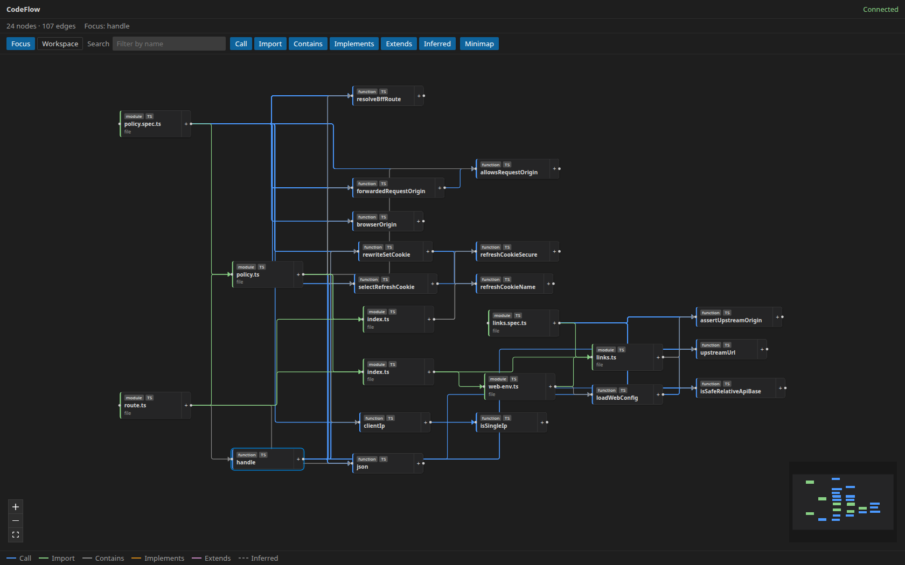
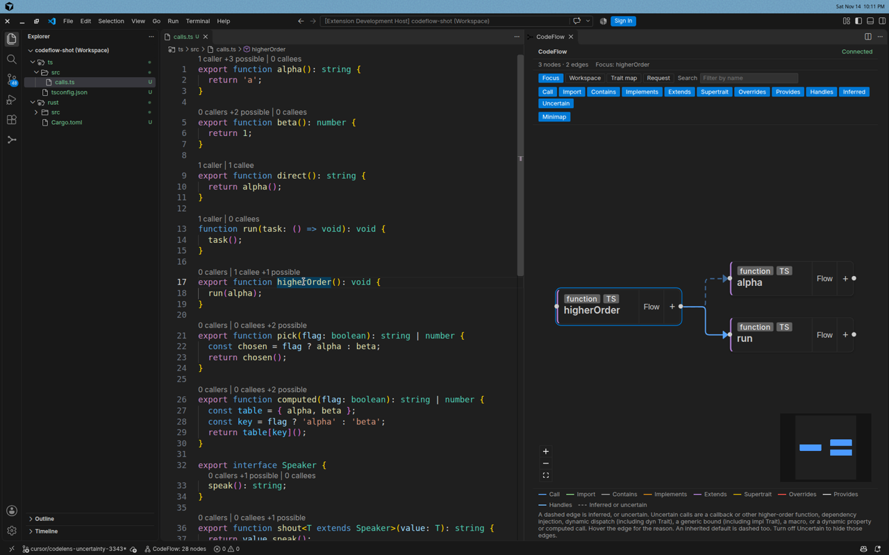
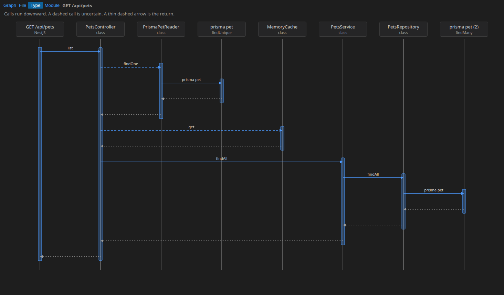
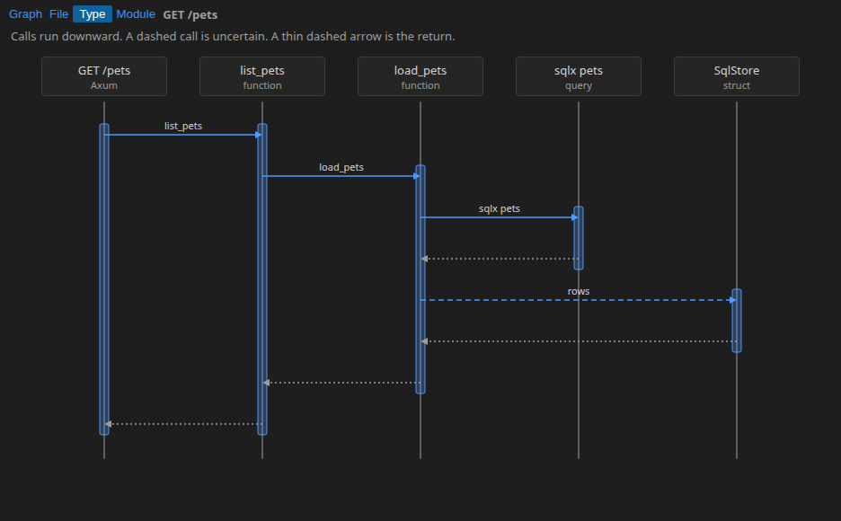
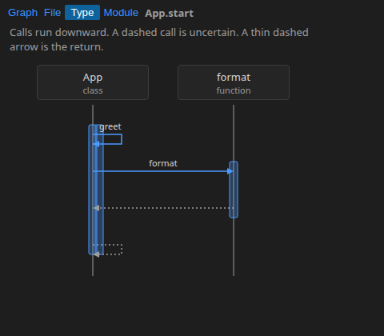

# CodeFlow

[](https://github.com/rezis-work/codeflow/actions/workflows/ci.yml)

CodeFlow is a VS Code extension that runs in Cursor. Beside the code, it shows interactive diagrams of how that code flows: call graphs, a flowchart for one function, a sequence of calls between files, classes, or modules, a Rust trait and impl map, a request traced from its route to the data layer, and file or crate dependency maps. Later phases add runtime traces.

Phase 1 speaks TypeScript, JavaScript, and Rust. Python comes later. Every language feeds one language-neutral graph through its own adapter, so a new language does not invent a new diagram model.

Open a supported file, right-click, and choose **CodeFlow: Show Flow for Symbol at Cursor** (or press Ctrl+Alt+F, Cmd+Alt+F on macOS). The diagram opens beside the editor. Click a node to select that symbol and center it in the editor. Moving the cursor highlights the matching node. Saving the file updates the diagram without throwing away the layout. CodeFlow keeps analysis on your machine. It has no telemetry and it does not call paid services.







## Features

- Call neighbourhood for the symbol under the cursor, plus callers-only and callees-only views.
- CodeLens above each function and method: caller and callee counts from that same graph. Uncertain calls are counted beside them (`+2 possible`). Click a count to open Show Callers or Show Callees.
- Control flow for the function at the cursor: `if`, `switch`, loops, `try`/`catch`/`finally`, early returns, `await`, and `yield`, for TypeScript, JavaScript, and Rust.
- Rust trait map: a trait and every workspace impl, or a type and the traits it implements. `dyn Trait`, generic bounds, and `impl Trait` call targets are drawn dashed and marked uncertain.
- Request flow: Next.js, NestJS, Axum, and Actix entry points, traced from the route through the handler's calls to a data-layer sink. The side panel lists those entry points.
- Sequence view: the same request, or the calls from one function, as a timeline. Lifelines can be the file, the class, impl, or struct, or the module or crate. Uncertain calls stay dashed.
- Saved flows: name the diagram you are looking at and open it again later. CodeFlow stores the view and the symbol, then analyzes the current code when you reopen it. If that symbol is gone, it shows the last picture and says the flow is stale.
- Export the open diagram to PNG, SVG, or Mermaid, or copy the Mermaid source. Uncertain edges stay dashed.
- Import diagram for the current file, and a dependency diagram for a file or folder in the explorer.
- Click a node to open its source in the text editor's column, with the symbol selected and centered. A missing file is reported in the panel instead of failing the command.
- Cursor following. The innermost function, method, or type at the caret is highlighted. The file module is the fallback. The diagram pans to it and does not lay out again.
- Incremental refresh when a file is saved, when the watcher sees a create, change, or delete, and when git moves `HEAD`. Bursts of changes are analyzed once.
- Status bar item: analyzing, the node count, or an error. Clicking it opens the panel.
- TypeScript path aliases, several tsconfig projects in one workspace, npm/yarn `workspaces`, and `pnpm-workspace.yaml`.
- Rust workspaces via `cargo metadata`, with a Cargo.toml scan when cargo is missing or the metadata command fails. rust-analyzer is optional and only upgrades the calls of the symbol you asked to show.

## Commands

These appear in the Command Palette. The four call and import commands also appear in the editor context menu for TypeScript, TSX, JavaScript, JSX, and Rust. **Show Control Flow for Function at Cursor**, **Show Request Flow**, and **Show as Sequence** appear in that menu for those languages. Control flow is also on a function or method node in the call diagram. **CodeFlow: Show Trait Map** appears in that menu for Rust. **CodeFlow: Show Dependencies** appears on files and folders in the explorer. The diagram toolbar and the side panel can switch to the trait map. The side panel lists entry points and saved flows. A row opens a request flow, and its Sequence button opens that route as a sequence. Saved Flows lists named diagrams: open, rename, or delete. Delete asks first.

| Command                                            | What it draws                                                                             |
| -------------------------------------------------- | ----------------------------------------------------------------------------------------- |
| CodeFlow: Show Flow for Symbol at Cursor           | Undirected neighbourhood of the symbol, depth 2, every edge kind                          |
| CodeFlow: Show Callers                             | Incoming call edges, depth `codeflow.editor.callDepth` (default 2)                        |
| CodeFlow: Show Callees                             | Outgoing call edges, same depth                                                           |
| CodeFlow: Show File Dependencies                   | Import edges of the current file's module                                                 |
| CodeFlow: Show Dependencies                        | The same import view for a file, or the file modules inside a folder plus one import hop  |
| CodeFlow: Show Control Flow for Function at Cursor | Flowchart of the function at the cursor (TypeScript, JavaScript, and Rust)                |
| CodeFlow: Show Trait Map                           | Rust trait, its impls and methods, or a type and the traits it implements                 |
| CodeFlow: Show Request Flow                        | One route, its handler, the calls below it, and the data-layer calls those functions make |
| CodeFlow: Show as Sequence                         | That request, or the function at the cursor, as a sequence of calls and returns           |
| CodeFlow: Open Diagram                             | The panel, without changing the current symbol                                            |
| CodeFlow: Save Flow                                | Name the open diagram and store its definition                                            |
| CodeFlow: Open Saved Flow                          | Pick a saved flow and analyze it again                                                    |
| CodeFlow: Export PNG                               | Save the open diagram as a PNG                                                            |
| CodeFlow: Export SVG                               | Save the open diagram as a self-contained SVG                                             |
| CodeFlow: Export Mermaid                           | Save Mermaid source for the open diagram                                                  |
| CodeFlow: Copy Mermaid                             | Copy that Mermaid source to the clipboard                                                 |

**Ctrl+Alt+F** (**Cmd+Alt+F** on macOS) runs Show Flow while a supported editor has focus. It does not use Format Document (Shift+Alt+F), Find (Ctrl+F), or the Cursor chat shortcuts (Ctrl/Cmd+L, Ctrl/Cmd+K, Ctrl/Cmd+I). On a Linux TTY, Ctrl+Alt+Fn switches virtual terminals; Ctrl+Alt+F does not.

## Settings

| Setting                                | Default                                   |                                                                                                                                        |
| -------------------------------------- | ----------------------------------------- | -------------------------------------------------------------------------------------------------------------------------------------- |
| `codeflow.editor.followCursor`         | `true`                                    | Highlight the symbol at the cursor in the open diagram                                                                                 |
| `codeflow.editor.refocusOnCursor`      | `false`                                   | In focus mode, rebuild the neighbourhood when the symbol is not in the current diagram. Otherwise the panel says "Not in this diagram" |
| `codeflow.editor.callDepth`            | `2`                                       | Call steps for Show Callers, Show Callees, a request flow, and a sequence (1–32). The route itself is not a step                       |
| `codeflow.view.defaultMode`            | `focus`                                   | `focus` or `workspace`. Trait map and request flow are opened by their own commands                                                    |
| `codeflow.view.maxNodes`               | `300`                                     | Nodes drawn at once. Also caps trait-method fan-out and a request flow                                                                 |
| `codeflow.rust.useRustAnalyzer`        | `true`                                    | Upgrade the focused symbol's calls when rust-analyzer is already running                                                               |
| `codeflow.codeLens.enabled`            | `true`                                    | Caller and callee counts above functions and methods. Uncertain calls are `+N possible` and are not part of the main count             |
| `codeflow.savedFlows.storeInWorkspace` | `false`                                   | Write named flows to `.codeflow/flows.json`. Off keeps them in this window's workspace storage                                         |
| `codeflow.export.pngScale`             | `2`                                       | PNG export scale from 1 to 4                                                                                                           |
| `codeflow.export.background`           | `theme`                                   | `theme` follows the color theme. `light` forces a white background for PNG and SVG                                                     |
| `codeflow.exclude`                     | dist, out, build, coverage, min.js, .next | Extra skip globs, combined with `files.exclude`                                                                                        |
| `codeflow.maxFiles`                    | `2500`                                    | Files analyzed per language, per workspace folder                                                                                      |

## Requirements

- Node.js 22 or newer to build from source
- Cursor, or VS Code 1.85 or newer
- For Rust, a `cargo` on `PATH` so `cargo metadata --no-deps` can name the crates. Without it, CodeFlow reads `Cargo.toml` and `src/` and shows a warning
- rust-analyzer is optional. CodeFlow does not install it, activate it, or index the workspace through it

## Real projects

Measured on this machine with the extension's analyzer workers, not in CI. The lovepet tree is a private pnpm monorepo (`apps/web`, `apps/api`, and `packages/*`). ripgrep 15.2.0 is a Cargo workspace. Neither project is vendored in this repository.

| Project | Files | Nodes | Edges | First analysis | One-file update |
| ------- | ----- | ----- | ----- | -------------- | --------------- |
| lovepet | 223   | 1,018 | 3,414 | 3.5 s          | 243 ms          |
| ripgrep | 102   | 3,520 | 7,248 | 878 ms         | 275 ms          |

lovepet was not capped and produced no warnings. The route handler `handle` in `apps/web/app/api/v1/[...path]/route.ts` calls `resolveBffRoute` through the `@/` path alias and `loadWebConfig` / `upstreamUrl` in `@lovepet/config`, both `certain`. That package's `exports` point at `dist/`, which is not built here; CodeFlow follows `pnpm-workspace.yaml` and the TypeScript source instead.

ripgrep was read with `cargo metadata` (Cargo 1.100). Cargo 1.83 cannot parse its edition 2024 manifest, and the Cargo.toml fallback still indexed all 102 files (901 ms, 7,217 edges). The diagram above is `rg::search::SearchWorker::search_reader`.

## Known limitations

- Macros are not expanded. A `name!()` call is an uncertain edge only when `name` is a workspace function. `#[cfg]` is not evaluated, so both branches are kept when they parse as items.
- CodeLens counts direct call edges, not the depth used by Show Callers. A function passed as an argument is an uncertain callee of the caller. The function that receives it does not list every function that might be passed in. A closure that is not a named function or method has no CodeLens.
- Calls are not a whole-program type inference. TypeScript marks a call `certain` when the checker names one workspace function. Rust marks a call `certain` from syntax or, for the symbol you just showed, from rust-analyzer.
- External packages and the Rust standard library are not nodes. An import edge stops at the workspace.
- `codeflow.maxNodes` (default 300) caps what is drawn. `codeflow.maxFiles` (default 2500) caps what is analyzed.
- Git worktrees, where `.git` is a file, are not watched for branch switches. A normal checkout's `HEAD` is.
- The diagram reveal ignores the cursor move it just caused. A later move in that editor is followed.
- Control flow does not branch on `?.`, `??`, `&&`, or `||`. A ternary is a decision only when it is the whole statement, the arrow body, the return value, or a single binding. Nested functions stay one collapsed block. Implicit exceptions from calls are not drawn. A function with more than 500 blocks is truncated. Anonymous functions are refreshed from the range they had when the flowchart opened.
- A route whose path is computed, or registered through a callback CodeFlow cannot follow, is listed as `unresolved path`. A handler written as a closure is one collapsed node. NestJS route versioning is ignored. A global prefix is applied only when `setGlobalPrefix` is given a string literal.
- NestJS constructor injection of a concrete class is a certain call. Injection of an interface, an abstract class, or an `@Inject` token is an uncertain edge to the providers that match. Those edges are stored on the controller file, so they refresh when that file is reanalyzed. A decorator imported from a package that is not part of the program is recognized by the imported name.
- Drizzle `select` / `insert` / `update` / `delete` match a named receiver such as `db`. A repository call such as `this.usersRepository.delete` is TypeORM. A Mongoose model is a capitalized name; a receiver ending in `Factory` is left alone.
- Request-flow data sinks are name matches (`prisma.pet.findMany`, `sqlx::query!`, `pets::table.load`, and the other rows in the detector table). The database client itself is not a call-graph node. A `fetch` to an `http` or `https` URL is an external sink.
- A sequence is the trace turned on its side. It does not discover new calls. A recursive call is drawn once. The diagram stops at `codeflow.editor.callDepth` or at 80 calls and says it was truncated. A request sequence keeps a sink that the trace attached past that depth, and says so when the trace left other calls out.
- An `alt` frame is one box around a decision, not a separate else compartment. `&&`, `||`, `?.`, and `??` are not frames. Frames are attached for up to eight functions on the trace, and only when that function's control flow can be built. The box can include the gap between the blocks it covers.
- At class, impl, or struct granularity, a free function is its own lifeline. A route and a data sink stay their own lifelines at every granularity. A Rust file module is labelled as the crate.
- PNG, SVG, and Mermaid export use a deterministic layout, not the on-screen ELK positions. Mermaid lays the diagram out again when you render it. PNG text uses a built-in bitmap font. A saved viewport is applied to the call graph. A sequence does not use it. Control flow keeps its own fit-to-view.

## Layout

The npm workspace is split so later phases can land without rearranging the repo.

| Path                 | Role                                                                                                                                                                                                                                                                                            |
| -------------------- | ----------------------------------------------------------------------------------------------------------------------------------------------------------------------------------------------------------------------------------------------------------------------------------------------- |
| `packages/shared`    | Language-neutral code graph, the per-file graph store, and the typed messages between the extension and the webview. Pure TypeScript, with no VS Code API, so both sides import it.                                                                                                             |
| `packages/extension` | VS Code extension host: commands, the activity bar, and webview panels. esbuild bundles the host and, separately, the TypeScript worker and the Rust worker. Rust uses tree-sitter (WASM) and cargo metadata, and can upgrade the focused symbol's calls when rust-analyzer is already running. |
| `packages/webview`   | React diagram, built with Vite. React Flow draws the graph and ELK lays it out. The webview talks to the extension only with `postMessage`.                                                                                                                                                     |

The webview production bundle is written to `packages/extension/media/webview`. The extension generates the panel HTML and sets a nonce-based Content Security Policy: `default-src 'none'`, scripts only when they carry that nonce, styles from the extension bundle, and `style-src-attr 'unsafe-inline'` so React Flow can position nodes. Scripts stay nonce-only. There is no `unsafe-eval` and no remote load.

## Prerequisites

- Node.js 22 or newer (`nvm use` reads `.nvmrc`)
- npm 10 or newer
- Cursor, or VS Code 1.85 or newer

`engines.vscode` is `^1.85.0`. That floor is intentionally conservative so the extension loads in current Cursor, which tracks a newer VS Code. `@types/vscode` is pinned to 1.85 so the typechecker rejects newer APIs.

Integration tests launch a real extension host. On Linux without a display, install `xvfb` and run them under `xvfb-run`.

## Development

```bash
npm install
npm run build
```

`npm run watch` rebuilds the extension and the webview as you edit. Open this folder in Cursor or VS Code and press F5 (**Run CodeFlow**) to launch an Extension Development Host. The pre-launch task builds both packages.

Then:

- Click the CodeFlow icon in the activity bar. The sidebar has **Open Diagram**, **Show Trait Map**, and an **Entry Points** list.
- Run **CodeFlow: Open Diagram** from the Command Palette.

The panel shows the diagram. The React view sends `ready`. The extension answers `ack`, then the current theme and the current view of the graph. Click a node to open that symbol in the editor. The expand button asks for its neighbours. **CodeFlow: Show Flow for Symbol at Cursor** centers a depth-2 neighbourhood of the symbol under the cursor. The toolbar switches that focus view, the whole workspace graph, the trait map, and the request flow. If the panel says the diagram view is not built, run `npm run build` from the repository root.

Indexing starts after the window is up and does not block activation. TypeScript and JavaScript follow `tsconfig.json` and `jsconfig.json`, including `paths`, and a folder with neither uses a plain JavaScript project. Workspace packages are read from `package.json` `workspaces` and from `pnpm-workspace.yaml`. Rust follows `cargo metadata` when cargo is installed, and otherwise reads `Cargo.toml` and `src/`. Edits, saves, watcher events, and git `HEAD` changes are re-analyzed after a short pause, and a burst of paths is one pass. `codeflow.exclude` and `files.exclude` skip files, `node_modules` is always skipped, Rust also skips `target/`, and `codeflow.maxFiles` caps how many files each language contributes in a workspace folder (the default is 2500). The two languages share one graph and keep their own file lists. The status bar shows analyzing, the node count, or an error, and opens the panel when clicked.

```bash
npm run lint
npm run format:check
npm run typecheck
npm test
npm run test:integration
```

`npm test` runs Vitest for the extension host and the webview. `npm run test:integration` is the `@vscode/test-electron` smoke test. GitHub Actions installs dependencies, lints, checks formatting, typechecks, runs both test suites, builds, and uploads `codeflow.vsix`.

## Build a VSIX and install it in Cursor

```bash
npm run package
```

That builds both packages and writes `codeflow.vsix` at the repository root.

In Cursor, open the Extensions view, open the `…` menu, choose **Install from VSIX…**, and select `codeflow.vsix`.

From a terminal:

```bash
cursor --install-extension codeflow.vsix
```

Reload the window if the CodeFlow icon does not appear immediately. The installed extension id is `codeflow.codeflow`.

## Graph model

`packages/shared` is the model both sides share.

A node is a function, a method, a type, a module, an impl, a route, or a data-layer sink. A type node also says whether it is a class, interface, struct, enum, or trait. A file is a module node whose qualified name is `.`. Nested modules use their own qualified names and still carry the file URI. Route and sink nodes are built for the request-flow view. They are not stored in the workspace graph.

A node id is the language (`ts`, `js`, or `rust`), the file URI, and the qualified name. Build it with `nodeId`. Pass `vscode.Uri.toString()` and keep that form. The store only turns backslashes into slashes and drops a trailing slash. TypeScript and JavaScript qualified names join scopes with `.` (`App.start`). Rust qualified names join them with `::` (`app::App::start`). The store does not parse the name.

An edge is a call, an import, a contains link, an implements or extends link, a provides link, or a handles link from a route to its handler. Edges point from caller to callee, from the importing file to the imported file, from a container to its member, and from a type to the type it implements or extends. Each edge is `certain` or `inferred`. An uncertain edge carries a `reason`: `callback`, `dependency-injection`, `dynamic-dispatch` (`dyn Trait` or an unresolved receiver), `generic-bound` (`impl Trait` included), `macro`, or `dynamic-property`. An inherited default and a fan-out cap stay uncertain without a category. Uncertain edges are drawn dashed. Two call sites between the same symbols stay as two edges. Confidence and the reason are not part of the edge id, so a later pass can upgrade `inferred` to `certain` in place.

Analyzers should put each edge in the file where the relationship is written. Emit a cross-file edge only when the target file is known, so the target node id can be built. Skip the edge when the target file is unknown. The store keeps an edge pending until both endpoints exist, then resolves it. Invalidating the target file makes the edge pending again. Invalidating the file that owns the edge deletes it.

`createGraphStore` merges one fragment per file. A fragment carries that file's nodes and edges, a content hash, and an optional editor version. Ingesting the same URI, hash, and version is a cache hit and does not rebuild the file. A new hash or version replaces that file only. `hashContent` is a small FNV-1a fingerprint analyzers can use; any stable hash is fine. Omitting the version matches only a fragment that was stored without one.

`neighbours` walks callers (incoming) and callees (outgoing) up to a depth. The default edge kind is `call`, and `both` is the union of those two directed walks. `subgraph` is the undirected ball around a focus node and includes every edge kind unless the query says otherwise. `serializeGraphStore` writes the fragments to JSON and `deserializeGraphStore` reads them back, including pending edges and cache keys.

The webview protocol is a discriminated union checked by hand, so the bundle does not take on a schema library:

- Webview to extension: `ready`, `requestGraph`, `revealLocation`, `expandNode`, `setViewMode`, `requestControlFlow`, `dismissControlFlow`, `requestSequence`, `dismissSequence`, `viewState`, `saveFlow`, `exportDiagram`, `copyMermaid`.
- Extension to webview: `ack`, `graphSnapshot`, `graphDelta`, `focusNode`, `config`, `cursorHint`, `error`, `controlFlow`, `controlFlowCursor`, `sequence`, `savedFlowBanner`, `presentation`.

`requestControlFlow` asks for one function, by a call-graph node id or by a file URI and a cursor position. `controlFlow` answers with a versioned graph (`version: 1`) or an error. `dismissControlFlow` leaves the flowchart. `controlFlowCursor` is the caret, so the open flowchart can highlight the block that contains it. `requestSequence` asks for the open request or the open function as a sequence, optionally at `file`, `type`, or `module` granularity. `sequence` answers with a versioned diagram (`version: 1`) or an error (`not-found`, `not-a-function`, or `internal`). `dismissSequence` leaves the sequence. Older messages are unchanged.

`ready` receives `ack`, then the theme and the current view. In focus mode with a symbol, that view is the depth-2 neighbourhood and a `focusNode`. Otherwise it is the whole workspace graph. A snapshot replaces the diagram's current view. A delta patches it. `requestGraph` answers with the subgraph around that symbol. `expandNode` patches in a wider one. `setViewMode` switches the session between `focus` and `workspace` and sends that view again. `config` may include `viewMode` and `maxNodes`. The workspace graph lives in `packages/extension/src/workspaceGraph.ts`. Analyzers should call `getWorkspaceGraph().ingest(fragment)` and `invalidate(uri)`.

## Diagram

The panel is a React Flow canvas. ELK lays the graph out left to right with the layered algorithm. The bundled ELK build (`elkjs/lib/elk.bundled.js`) runs that layout through an in-process stand-in for a worker: it schedules the pass with `setTimeout`, and it does not use `eval`, `new Function`, a blob URL, or a real `Worker`. That keeps the nonce CSP intact. The pass still occupies the UI thread once the timer fires, so `codeflow.view.maxNodes` (default 300) caps how many nodes are drawn. elkjs is licensed under the EPL-2.0 or GPL-3.0-or-later; React Flow is MIT. Minification can drop the elkjs header, so the license is recorded here.

A snapshot, and any change to the edge filters, lays the visible graph out again and fits every node in view. A delta keeps the positions of nodes that were already placed and only lays out the new ones, then shifts that component to the right of the existing graph. Dragging a node is kept across later deltas. A later `focusNode` (the cursor moved onto a symbol that is already drawn) pans to that node and does not lay the graph out again. Reduced motion makes that pan instant. `cursorHint` is the short "Not in this diagram" line.

A single click on a node sends `revealLocation`. The extension opens that file in a text editor column, not on top of the diagram, selects the symbol's range, and reveals it in the center. A range past the end of the file is clamped. A file that has been deleted posts an error and does not throw. The expand button sends `expandNode` and does not open the file. Hovering a node emphasizes its edges. The toolbar has fit and zoom (React Flow controls), a minimap toggle, a name search, switches for each edge kind, and switches for inferred edges and uncertain edges, plus Focus, Workspace, Trait map, and Request. Certain edges are solid. Inferred edges, and edges marked uncertain, are dashed and dimmer. The tooltip says `inferred`, or the reason (`uncertain: callback / higher-order`, `uncertain: dependency injection`, `uncertain: dynamic dispatch / dyn Trait`, `uncertain: dyn Trait`, `uncertain: generic bound`, `uncertain: impl Trait`, `uncertain: macro`, `uncertain: dynamic property / computed call`, `uncertain: DI interface`, `uncertain: custom provider token`, `uncertain: unresolved receiver`, or an inherited default). The legend says the same. Turning off **Uncertain** hides those edges in every diagram, including the flowchart's uncertain panic edges.

Node colour follows the kind (function, method, type, impl, module, route, sink). A type shows its `typeKind` (struct, enum, trait, class, interface). An impl node carries a short note: trait impl, generic impl, blanket impl, inherent impl, derived impl, override, or required. A route node is labelled with the method and path. A sink node is labelled with the library and, when a literal was found, the table, model, or URL. A small badge shows `TS`, `JS`, or `RS`. Qualified names are shown as the analyzers stored them: `.` between TypeScript and JavaScript scopes, `::` between Rust scopes. A file module is labeled with the file name.

A Rust `mod` declaration and the file it points at are two nodes joined by an import. The diagram hides the file node, keeps the module, and retargets the file's edges onto that module. The collapsed file name is shown on the module. TypeScript file modules stay visible.

`codeflow.view.defaultMode` is `focus` or `workspace` (default `focus`). Focus mode draws the depth-2 neighbourhood. Workspace mode draws the whole graph and still highlights `focusNode`. Trait map is opened by **CodeFlow: Show Trait Map** or the toolbar. It is centred on a trait (the trait, its supertraits, every impl, and the methods those impls override or inherit) or on a type (the type and the traits it implements). Request flow is opened by **CodeFlow: Show Request Flow**, by a row in the side panel, or by the Request toolbar button once a route has been chosen. Clicking a node and moving the cursor work the same way as the other views. When the cap hides nodes, the panel says so and, in workspace mode, suggests focus mode. A trait map that is larger than `codeflow.view.maxNodes` keeps an overflow node. The diagram uses VS Code theme colours, including high contrast, and turns motion off when the user prefers reduced motion. TypeScript and Rust nodes from one workspace are drawn together.

While the host has not sent a graph, the panel says it is analyzing if it is already connected, and otherwise that there is no diagram yet. An `error` message replaces the canvas with that text.

A request-flow diagram has a Sequence button. It opens the same trace as a sequence. The sequence toolbar switches File, Type, and Module, and Graph returns to the call diagram. The sequence layout is not ELK: lifelines are columns and message order is the row. See [Sequence](#sequence).

**Save flow** is in the header of every diagram. It asks for a name. CodeFlow stores the view kind, the root symbol or entry point, depth or granularity, the uncertain and inferred switches, collapsed nodes, and the viewport after you pan or zoom. Opening the flow analyzes the current code. The side panel's Saved Flows section lists them. **CodeFlow: Open Saved Flow** is a quick pick of the same list. If the root symbol or entry point is gone, the panel shows the last rendered diagram and a stale banner. By default the list is in workspace storage for this window. `codeflow.savedFlows.storeInWorkspace` writes `.codeflow/flows.json` with paths relative to the workspace. The file is version 1. A document that does not parse is not overwritten.

**Export** in the same header saves PNG, SVG, or Mermaid, or copies the Mermaid source. PNG uses `codeflow.export.pngScale`. The menu's white-background PNG, and `codeflow.export.background` set to `light`, paint a white page instead of the theme. SVG embeds its styles, falls back through `"Segoe UI", "Helvetica Neue", Arial, sans-serif`, and keeps uncertain edges dashed. Mermaid uses `flowchart` for a call graph, file dependencies, a trait map, and a request flow, with a subgraph per file and per module. Uncertain edges are `-.->`. A sequence is a `sequenceDiagram`. Control flow is a top-to-bottom `flowchart`, with diamonds for decisions and dashed exception edges. Identifiers and labels are escaped.

A function or method node has a Flow button. It opens a top-to-bottom flowchart of that function (ELK layered, direction down). Decisions and switches are marked, loops are dashed, entry and exit are rounded, returns and throws use their own borders, and exception edges are dashed. Back edges leave the right side of a block. Clicking a block selects its source range. The breadcrumb returns to the call graph. Saving the file rebuilds the flowchart. If the function is gone, the panel says so. A function with more than 500 blocks shows the first 500 and a notice. The same command is **CodeFlow: Show Control Flow for Function at Cursor**. It works for TypeScript, JavaScript, and Rust.

## Sequence

**CodeFlow: Show as Sequence** draws one traced path as a timeline. On a function it walks the outgoing calls. On an entry point it walks the request trace: the route, the handler, the calls, and the sinks. The side panel's Sequence button and the request diagram's Sequence button open the request. Graph on the sequence returns to the call diagram.

Lifelines are chosen with File, Type, or Module:

- File is one lifeline per file. Two methods in the same file share it.
- Type is a class, impl, struct, enum, trait, or interface. A class is preferred over the impl that contains the method, so `PetsController`, `PetsService`, and `PetsRepository` stay apart. A free function is its own lifeline. This is the default.
- Module is the closest module. A Rust file module is noted as the crate.

Calls run downward. Each call has a return arrow and an activation bar, and a nested call opens its bar inside the caller's bar. A self-call hooks back onto the same lifeline. An uncertain call is dashed. Its tooltip is the call-graph reason (`uncertain: dependency injection`, `uncertain: dynamic dispatch / dyn Trait`, and the other categories). A note that has no category stays as that note. Clicking a message or a lifeline selects that source.

A loop or a branch becomes a `loop` or `alt` frame when a call's location sits inside the control-flow range. The frame is attached after the calls are drawn, for up to eight functions, and a flowchart that cannot be built leaves those calls unframed. An `alt` frame is one box around the decision, not a separate else compartment. `&&`, `||`, `?.`, and `??` are not frames, because control flow does not make them decisions.

A call whose target is already on the stack is marked recursive and is not expanded again. The walk stops at `codeflow.editor.callDepth` or at 80 calls and sets `truncated` with a note. A request sequence follows every call the request trace kept, so a sink past the depth cap is still drawn, and the note says when the trace left other calls out. Route and sink lifelines stay separate at every granularity.

The shared model is `SequenceDiagram` in `packages/shared`. Participants, messages (`call` or `return`), activations, and frames are checked by hand. The payload version is `1`.







## Request flow

**CodeFlow: Show Request Flow** draws one entry point. Put the cursor in a handler and the command traces that route. Otherwise it asks you to pick one. The side panel's Entry Points section lists every detected route, grouped by framework and package, with a count and a filter. A row opens the trace. Source jumps to the handler. Saving a route file refreshes that file's entries.

Detection is static. Nothing is executed.

- Next.js App Router: exported `GET`, `POST`, `PUT`, `PATCH`, `DELETE`, `HEAD`, and `OPTIONS` from `app/**/route.ts` (and `.tsx`, `.js`, `.jsx`, `.mjs`, `.cjs`), including under `src/`. A route group `(shop)` is omitted from the path. A parallel slot `@modal` is skipped. A dynamic segment stays in the path (`[id]`, `[...slug]`, `[[...slug]]`). An intercepting segment is kept and marked uncertain. A re-exported handler uses the export name as the method and the resolved function as the handler.
- Next.js Pages Router: a default export under `pages/api` is method `ALL`. `middleware.ts` is an entry point. A string `config.matcher` becomes the path. A computed matcher is `unresolved path`. With no matcher the path is `*`.
- Server Actions: a file or function with `'use server'` is an `ACTION` entry point.
- NestJS: `@Controller(prefix)` methods decorated with `@Get`, `@Post`, `@Put`, `@Patch`, `@Delete`, `@Head`, `@Options`, or `@All`. `app.setGlobalPrefix('api')` is applied when the argument is a string. A non-literal path is `unresolved path`. A constructor parameter typed as a class is a certain call to that class. An interface, an abstract class, or an `@Inject` token fans out, uncertain, to the matching providers.
- Axum: `Router::new().route`, method-router chains, `.nest`, `.merge`, and a helper that returns a `Router` and is passed to `.nest`, `.merge`, `axum::serve`, or returned. A handler named as a function is a node. A closure is one collapsed uncertain node. A `State` extractor is noted on the route.
- Actix: `#[get]` / `#[post]` / `#[put]` / `#[delete]` / `#[patch]` / `#[head]` / `#[route]`, `web::resource(path).route(web::get().to(handler))`, `web::scope`, `App::new().service` / `.route`, and `configure`. An attribute route mounted with `.service(handler)` keeps the scope prefix. An unmounted attribute keeps the path on the attribute.

The trace is the route, a handles edge to the handler, then outgoing calls up to `codeflow.editor.callDepth` (default 2), and a sink on any function in that set that calls a known data client. The route itself does not consume a depth step. The node cap is `codeflow.view.maxNodes`.

The sink table lives in `packages/shared` and is the first match:

| Library                  | What counts as a sink                                                                                        |
| ------------------------ | ------------------------------------------------------------------------------------------------------------ |
| Prisma                   | `prisma.<model>.findMany` and the other model methods. The model name is the member before the method.       |
| Drizzle                  | `db.select` / `insert` / `update` / `delete`, and `db.select().from(table)`, and `db.query.<table>`          |
| TypeORM                  | repository and `EntityManager` methods, and `getRepository`                                                  |
| Mongoose                 | `Model.findOne` and the other model methods                                                                  |
| Kysely, Knex             | `selectFrom`, `insertInto`, `knex(table)`, `knex.from`                                                       |
| pg, postgres, neon       | `` sql`select …` ``, `pool.query`, `client.query`                                                            |
| fetch                    | an `http` or `https` URL, marked external. A non-literal URL is external and uncertain                       |
| sqlx                     | `query!`, `query_as!`, `query_scalar!`, and `sqlx::query`. A `fetch_*` on the same statement is the same hit |
| diesel                   | `.load`, `.get_result`, `.get_results`, and `.execute` on a `table`                                          |
| sea-orm                  | `Entity::find` and `ActiveModel` save or insert                                                              |
| tokio-postgres, deadpool | `client.query`, `execute`, `batch_execute`                                                                   |
| redis                    | `get`, `set`, `del`, `hget`, `hset`, and `redis::cmd`                                                        |

A workspace package is the longest package directory that contains the file, so a pnpm or npm workspace can list `@sample/web` separately from another package.

## Control flow

The shared model is `ControlFlowGraph` in `packages/shared`. One graph is one function. Blocks are `entry`, `exit`, a straight-line `statement`, a `decision` (`if` or `ternary`), a `switch`, a `loop` (`for`, `for-of`, `for-in`, `while`, `do-while`, or Rust `loop`), `try` / `catch` / `finally`, `return`, `throw`, `break`, `continue`, `await`, `yield`, or `call`. Each block has a short label and a source range. Edges are `true` / `false`, case values and `default`, `loop-body` / `loop-exit` / `back`, `exception`, `finally`, `fallthrough`, or an unlabeled `next`. `await` and `yield` are suspension points. A nested function is listed on its statement so the diagram can open that function’s own flowchart. The payload version is `1`. A graph with more than 500 blocks is rejected by the parser; the builder stops earlier and sets `truncated`. A throw may be marked `uncertain` when the panic is only a guess (`unwrap` / `expect`).

The TypeScript builder walks the syntax tree in the analyzer worker. It covers functions, methods, arrow functions, function expressions, constructors, getters, setters, async functions, and generators. `finally` is copied once per way of leaving the `try` (fall through, return, throw, break, continue), which matches a `return` inside `try` that must not also run the code after the `try`. A `return` inside `finally` replaces the pending return. Code after `return` or `throw` stays in the graph and is marked unreachable so the diagram can dim it. `for await` is a `for-of` loop that suspends. Short-circuit `and` and `or` decision kinds exist on the model. The TypeScript builder leaves `&&` and `||` inside the statement label.

The Rust builder walks the tree-sitter tree in the Rust worker and emits the same graph. It covers `if` / `else if` / `else`, `if let`, let-else, `match` (one edge per arm, the pattern as the label, guards included, `_` as the default), `loop` / `while` / `while let` / `for` with back edges, labeled `break` and `continue`, `break` with a value, explicit `return`, and a tail expression used as the return value. `?` is an early-return exception edge. `panic!`, `unreachable!`, `todo!`, and `unimplemented!` are throws. `assert!`, `assert_eq!`, and `assert_ne!` are decisions whose failing edge panics. `unwrap()` and `expect()` are uncertain panic edges; the success path stays. `.await` is a suspension point, the same way TypeScript `await` is. Closures, nested functions, and async blocks are one collapsed block that can be opened as its own flowchart. Code after `return`, `break`, `continue`, or a panic is marked unreachable. Impl methods and trait default methods work from the cursor and from the Flow button. The same 500-block cap applies.

Macros are not expanded, so only those panic and assert names are recognized, and tokens inside a macro are not blocks. `?` inside a `try` block is drawn as a return from the function. `unwrap` and `expect` are matched by method name, not by type. `&&` and `||` stay in the label. There is no borrow checker and no exhaustiveness check, so a `match` without `_` has no implicit default. A block that ends in `;` falls through to exit rather than drawing `return ()`. A `loop` in tail position joins its `break` values into one return. Qualified names from the cursor are syntactic (modules, the impl type, the function) and do not include the cargo crate prefix; the Flow button uses the name already stored on the call-graph node. Signature-only trait methods (no body) are entry and exit.

## Rust

The Rust adapter parses `.rs` files with the WASM build of tree-sitter-rust, so the vsix does not ship a platform-specific native module. `cargo metadata --no-deps` names the crates. When cargo is not installed, or metadata fails, CodeFlow scans `Cargo.toml` and `src/` instead and shows one warning.

It records free functions, structs, enums, traits, trait methods, impl blocks, impl methods (on the type they belong to), and modules. A trait keeps its supertraits and whether each method is required or a default. An `impl Trait for Type` records the impl, including a generic impl (`impl<T: Display> Trait for Vec<T>`), a blanket impl (`impl<T: Bound> Trait for T`), an impl of a trait defined outside the workspace (such as `Display`), and each `#[derive(...)]` name as a derived impl. An inherent `impl Type` is recorded too. Methods written in the impl are overrides. A default method the impl does not write is an inherited `provides` edge. Module declarations cover inline modules and file modules (`foo.rs` and `foo/mod.rs`, including `#[path]`). Contains edges link a file, type, or impl to its members. `use` and `mod` become import edges when the path can be resolved (`crate::`, `self::`, `super::`, and another crate in the workspace). `impl Trait for Type` becomes an implements edge from the type and from the impl node. Calls are read from the syntax: `foo()`, `Type::new()`, method calls, and universal function call syntax (`Trait::method(x)` and `<T as Trait>::method`). A call on a concrete type resolves to that type's impl, or to the trait's default method when the impl inherits it, and is `certain` when one workspace item matches. A receiver of `&dyn Trait`, `Box<dyn Trait>`, `Arc<dyn Trait>`, `Rc<dyn Trait>`, a generic bound (`T: Trait`), or `impl Trait` fans out to every workspace impl of that trait. Each of those edges is `inferred`, `uncertain`, and labelled with the reason. The same fan-out is used when the receiver cannot be named. If there are more targets than `codeflow.view.maxNodes`, the extra targets collapse into one overflow node. A call is also `inferred` when the receiver type was only guessed, as with `let widget = Widget::new()`, or when several inherent items match.

Macros are not expanded. A macro invocation is skipped, so tokens inside it are not turned into functions or calls. Attributes such as `#[path]` are read. `#[cfg]` is not evaluated, so both branches are kept when they are real items. `build.rs` is its own crate and is analyzed like any other file.

`codeflow.rust.useRustAnalyzer` (default true) asks rust-analyzer for the outgoing calls of the symbol under the cursor when you run **CodeFlow: Show Flow for Symbol at Cursor** or **CodeFlow: Show Trait Map**, and only then. The rust-analyzer extension must already be active; CodeFlow does not activate it or index the whole workspace through it. Those calls are stored as `certain` and replace the overlapping inferred edges, including an uncertain trait-method fan-out from that symbol. Without rust-analyzer, the tree-sitter graph is unchanged. The extension-host smoke test launches with `--disable-extensions` and does not install rust-analyzer, so that upgrade is covered by a unit test with a fake client.

**CodeFlow: Show Trait Map** needs a Rust file. On TypeScript or JavaScript it says the view is Rust only. Put the cursor on a trait, an impl, a type, or a method. A method lifts to its impl, then its trait, then its type.

Trait resolution is syntactic. It does not run rustc, so it does not check coherence: a blanket impl and a concrete impl of the same trait are both listed. External traits have no method bodies in the workspace, so inherited defaults are shown only for traits defined in the workspace. Impls that inherit a default share that default method as the call target. A `dyn` or generic call stays uncertain even when the workspace has only one impl, because an external impl could also match. Derived impls name the traits and do not expand the methods the derive would generate. Overlapping blanket and concrete impls are not rejected.

Not read yet: macro expansion, `include!`, full type inference, the bodies of standard-library traits, operator traits, closures as nodes, unions, type aliases, precise visibility inside a crate, and procedural macros.

## Roadmap

- **1.1 Scaffold** (done): extension and webview shells, strict CSP, tooling, CI, and a VSIX.
- **1.2 Shared graph model and message protocol** (done): the language-neutral graph, the per-file store, and the typed messages that carry it.
- **1.3 TypeScript analyzer** (done): the TypeScript compiler API reads `.ts`, `.tsx`, `.js`, `.jsx`, `.mts`, and `.cts` files into the shared graph. A worker thread does the analysis.
- **1.4 Rust analyzer** (done): tree-sitter-rust (WASM) and cargo metadata fill the same graph. rust-analyzer, when it is already running, upgrades calls for the symbol under the cursor. See [Rust](#rust).
- **1.5 Diagram webview** (done): React Flow and ELK.js draw the graph. See [Diagram](#diagram).
- **1.6 Editor integration** (done): context menus, callers and callees, file and folder dependencies, click-to-open in the editor column, cursor highlight, save and git refresh, and the status bar. See [Commands](#commands). CodeLens is phase 2.
- **2.1 Control flow for TypeScript and JavaScript** (done): a flowchart for one function. See [Control flow](#control-flow).
- **2.2 Control flow for Rust** (done): the same flowchart for Rust functions, methods, and trait defaults. See [Control flow](#control-flow).
- **2.3 Trait and impl map** (unreleased): Rust traits, every workspace impl, and the possible targets of a trait-method call. `dyn Trait`, generic bounds, and `impl Trait` are uncertain. See [Rust](#rust).
- **2.4 Request flow and entry points** (unreleased): Next.js, NestJS, Axum, and Actix routes, a trace from the route to a data-layer sink, and the side-panel entry list. See [Request flow](#request-flow).
- **3.1 Sequence view** (unreleased): a request trace or a function's calls as a timeline of lifelines, calls, and returns. See [Sequence](#sequence).

## License

[MIT](LICENSE).
